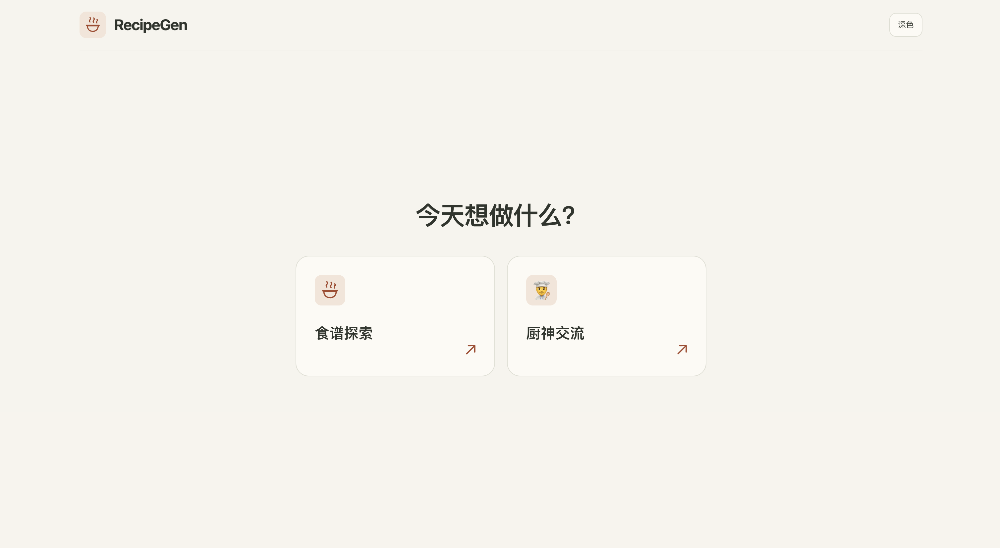
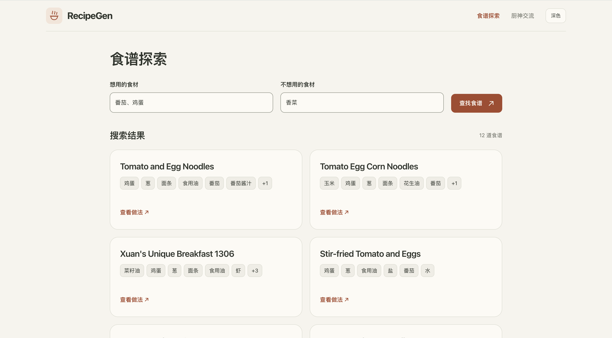
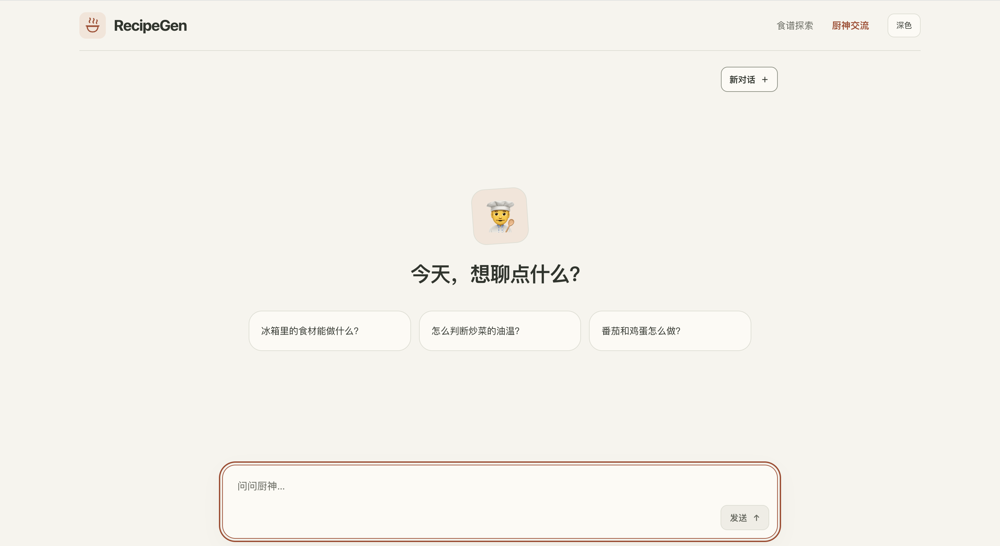

# RecipeGen：知识图谱食谱检索与问答

RecipeGen 将原始食谱构建为 **Neo4j 知识图谱**，结合 **BM25 关键词检索、本地 E5 语义排序与图谱条件查询**，通过 **DeepSeek API** 完成意图判断、候选重排和带来源的中文问答。

网页提供两个入口：**食谱探索**按想用、排除的食材查找食谱；**厨神交流**只需输入问题，支持多轮追问，由 LLM 决定直接回答还是检索食谱。

## 页面展示

### 首页



### 食谱探索



### 厨神交流



## 检索与问答流程

```text
用户问题 + 最近对话
        ↓
DeepSeek 意图路由与食材条件解析
        ├─ 一般交流 / 烹饪常识 → 直接回答
        └─ 查找食谱 / 原步骤追问
                 ↓
          BM25 全库关键词候选 A
          Cypher 完整条件候选 C → 仅在 C 内 E5 评分 → 语义候选 B
                 ↓
          A ∪ B ∪ C → 条件复核 → 合法候选池 C
                 ↓
          候选池内 BM25 / E5 双排名 RRF 融合
                 ↓
          一阶图谱证据回读：食材提及 + 全部有序原步骤 + Source
                 ↓
          有界完整上下文 → DeepSeek API 重排
                 ↓
          选定食谱原步骤 → DeepSeek API 问答 → 引用与数字校验
```

食谱探索直接执行检索并展示结果，不调用问答 LLM。厨神交流先把追问整理为独立问题及所需／排除食材，再进入同一检索链；LLM 不生成或执行任意 Cypher。

| 环节 | 实际方法 |
|---|---|
| 图谱条件 | 参数化 Cypher 查询完整候选集合 C，支持多食材同时满足及排除；语义评分之前完成筛选 |
| 关键词 | 本地 BM25，语料为每条食谱的标题和全部原步骤；`k1=1.5`、`b=0.75` |
| 语义 | 本地 `intfloat/multilingual-e5-small`，384 维、均值池化、L2 归一化；问题用 `query: `、食谱用 `passage: ` 前缀，仅对 C 内全部向量做精确余弦评分 |
| 融合 | 全库 BM25 正分 Top50、图谱先筛 E5 Top50 与 C 合并并复核条件；对完整合法池的 BM25/E5 排名做 RRF，`k=60`，BM25 零分不贡献关键词项 |
| 上下文 | RRF 后回读一阶图证据；最多 20 条完整食谱、60,000 JSON 字符预算，超限减少候选，保留所选食谱全部原步骤；问答使用重排后的 1～3 条 |
| 大模型 | DeepSeek 的 Chat Completions API；路由、重排与问答分别调用，已验证配置为 `deepseek-flash`；问答不使用本地 LLM |
| 输出校验 | 重排 ID 必须是输入候选的完整排列；问答证据 ID 必须指向原步骤，数字需来自引用文本；失败明确返回状态与原始证据 |

**图谱 C 是条件集合，没有第三个 RRF 排名。** 当前实现的最终合法池由图谱确定，BM25/E5 改变池内排序；图谱扩展补充步骤与来源证据，不额外创造食谱候选。原有 Neo4j 向量索引用于就绪核验，当前路径不做全库 ANN TopK 后过滤。

进一步说明见 [GraphRAG 设计](docs/GraphRAG设计.md)与 [厨神交流](docs/厨神交流.md)。

## 数据与验证

开发机器使用 [RUOXUAN123/RecipeGen](https://huggingface.co/datasets/RUOXUAN123/RecipeGen) 的 `test.zip`、`test-video.zip`，固定 revision 为 `2506260d8cb193ecdb18ac31fc725ffec43f6602`。保留两个归档的来源身份，共 **5,898 条食谱记录、44,802 行原始步骤**，没有跨归档去重。食材节点来自原文词典规则提及。

| 检索评测范围 | Precision@10 | Recall@10 |
|---|---:|---:|
| 32 条原始字段自动标注的条件回归查询，生产混合检索，DeepSeek 重排前 | **78.44%** | **41.65%** |

指标为逐题宏平均；Precision@10 固定分母为 10，即使返回不足 10 条。查询与标签已查看过，另有 8 条 dev 单独记录。这是食材条件回归，**不是人工语义相关性或问答准确率评测**。核查发现 RRF 改变了多数 Top10 排名，但本组查询的命中数与仅 E5 相同；现有指标不能证明融合增益。

单次真实聊天已完成 DeepSeek **意图路由 → 重排 → 问答**三次成功调用及真实 Neo4j 证据回读，未回退；结构、候选 ID、引用与数字检查通过，不代表回答的全部语义事实均已验证。发布范围和验证口径见 [发布验收摘要](reports/发布验收.md)。

## 本地运行

仓库包含源码、测试、文档、上述页面截图及手工演示数据。**真实语料、Neo4j 数据库、E5 权重、向量检查点、运行日志和凭据需要在本机自行准备，不随仓库发布。**

以下命令在仓库根目录执行，使用 Python 3.11 或更新版本及可用的 Neo4j 实例。首次读取语料与下载 E5 需要联网；数据脚本只读取测试文本和媒体成员目录，不下载全量图片／视频负载。

### 1. 安装与配置

```bash
git clone https://github.com/zhangjikaii/RecipeGen.git
cd RecipeGen
python3 -m venv .venv-mm
source .venv-mm/bin/activate
python -m pip install -r requirements.txt -r requirements-text.txt
cp .env.example .env
```

当前 E5 查询入口使用 `.venv-mm/bin/python`，因此请保留这个环境目录名。Windows 的子进程路径需先按平台调整；下面启动方式适用于 macOS／Linux。

编辑本地 `.env`，填写自己数据库与 API 的配置：

```dotenv
NEO4J_URI=bolt://127.0.0.1:7687
NEO4J_USER=neo4j
NEO4J_PASSWORD=填写自己的数据库密码
NEO4J_DATABASE=neo4j
RECIPEGEN_RETRIEVAL_MODE=hybrid
RECIPEGEN_LLM_PROVIDER=chat_completions
RECIPEGEN_LLM_BASE_URL=https://api.deepseek.com
RECIPEGEN_LLM_MODEL=deepseek-flash
RECIPEGEN_LLM_API_KEY=填写自己的API密钥
RECIPEGEN_LLM_TIMEOUT=120
```

模型 ID 可替换为自己账户可用的 DeepSeek 模型。凭据仅放本地 `.env`，不要提交 Git；macOS／Linux 可执行 `chmod 600 .env`。食谱探索不依赖大模型 API，厨神交流需要完成 API 配置。

需要新建本地 Neo4j 时，可使用仓库的 Docker Compose；填好 `.env` 后启动并等待数据库就绪。已有独立 Neo4j 实例可跳过此命令。

```bash
docker compose --env-file .env up -d
```

### 2. 重建来源图谱

```bash
python scripts/build_test_corpus.py \
  --archives test.zip test-video.zip \
  --revision 2506260d8cb193ecdb18ac31fc725ffec43f6602 \
  --output-dir data/test_graph
python scripts/build_test_graph.py \
  --records data/test_graph/records.jsonl --output data/test_graph
python scripts/import_test_graph_neo4j.py --validate-only
python scripts/import_test_graph_neo4j.py --report reports/local-graph-import.json
```

导入器读取 `.env`，导入后回读核验并激活构建；不删除既有图数据。为首次复现使用本项目的独立数据库。细节见 [测试集图谱构建](docs/测试集图谱构建.md)。

### 3. 准备本地 E5 与文本索引

```bash
python scripts/prepare_text_model.py
python scripts/build_text_index.py --device cpu --batch-size 8 --import
```

模型 revision 固定为 `614241f622f53c4eeff9890bdc4f31cfecc418b3`。权重下载至 `.runtime/text-model-cache/`；原文投影与可续跑向量检查点生成于 `data/graphrag/full/`，通过原生回读后生成 `data/graphrag/index-manifest.json`，并将 384 维向量写入 Neo4j 的 `RecipeGenText` 节点。BM25 复用同一原文投影。

当前网页每条食谱一个向量，不要求人工分块。E5 的 512 token 上限可能截断长食谱的编码输入，原步骤仍完整保存在图谱，LLM 上下文回读全文。缺失模型、完整向量或正确构建身份时须查看实际错误／回退信息，页面打开不代表数据已就绪。

### 4. 启动页面与核验状态

```bash
python -m recipegen serve --host 127.0.0.1 --port 8765
```

打开 [网页](http://127.0.0.1:8765/)或 [API 文档](http://127.0.0.1:8765/docs)，并用 `/api/system/status` 核验自己的数据数量、E5 与 API 配置。启动网页不会启动媒体识别批处理。

## API

| 接口 | 用途 |
|---|---|
| `GET /api/system/status` | 图谱身份、数量、模型就绪情况 |
| `POST /api/search` | 食材筛选与混合检索，返回食谱、原步骤、来源及执行信息 |
| `GET /api/recipes/{id}` | 原食谱详情 |
| `GET /api/system/graph?recipe_id={id}` | 食谱证据子图 |
| `POST /api/chat` | 提示词与最近对话，自动路由并执行检索问答 |
| `POST /api/generate` | 显式检索条件或食谱 ID 的证据问答，API 调用需指定 `mode=api` |

```bash
curl http://127.0.0.1:8765/api/system/status

curl -X POST http://127.0.0.1:8765/api/search \
  -H 'Content-Type: application/json' \
  -d '{"query":"番茄和鸡蛋怎么做","ingredients":["番茄","鸡蛋"],"excluded_ingredients":["香菜"],"retrieval_mode":"hybrid","limit":6}'

curl -X POST http://127.0.0.1:8765/api/chat \
  -H 'Content-Type: application/json' \
  -d '{"message":"推荐一道用番茄和鸡蛋、不放香菜的菜，并依据原步骤说明做法。","history":[]}'
```

追问时将前序 `user`／`assistant` 消息放入 `history`；最多 20 条，问题与历史合计最多 20,000 字符。聊天响应包含 `answer`、`recipes`、`evidence`、`route`、`generation` 和阶段 `trace`，可核对实际是否检索、调用 API 及发生回退。

## 开发与边界

```bash
python -m pytest -q
```

离线测试检查检索、接口、上下文与校验合同；真实 Neo4j 和收费 API 验证需要另行配置并显式运行，不能把历史报告当作新机器的运行结果。

- 食材关系表示原文提及，**不是完整配料表**；排除查询不保证忌口或过敏安全，系统不推算未知总烹饪时间。
- 问答基于已有食谱与原步骤，不声称生成的新配方已经验证；引用与数字校验不能替代全部语义核查。
- 图片／视频节点保留来源与目录关联；当前主要流程为文本检索问答，不在启动时运行视觉批处理。
- `data/example_graph.json` 是手工演示，旧 CLI／SQLite 入口保留用于功能演示，真实 `/api/search` 与 `/api/chat` 不以它替代 Neo4j。

核心代码：`recipegen/catalog.py`（条件与来源）、`recipegen/production_hybrid.py`（BM25/E5/RRF）、`recipegen/graphrag_retrieval.py`（图谱检索与证据回读）、`recipegen/chef_chat.py`（意图路由）、`recipegen/web_rag_answer.py`（API 重排与问答）、`recipegen/text_embeddings.py`（本地 E5）。第三方数据与模型的授权以各原始来源为准。
